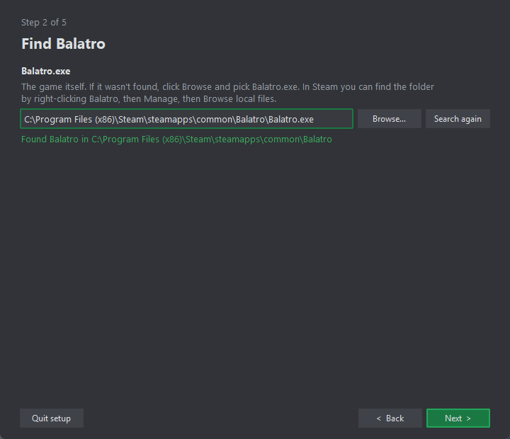
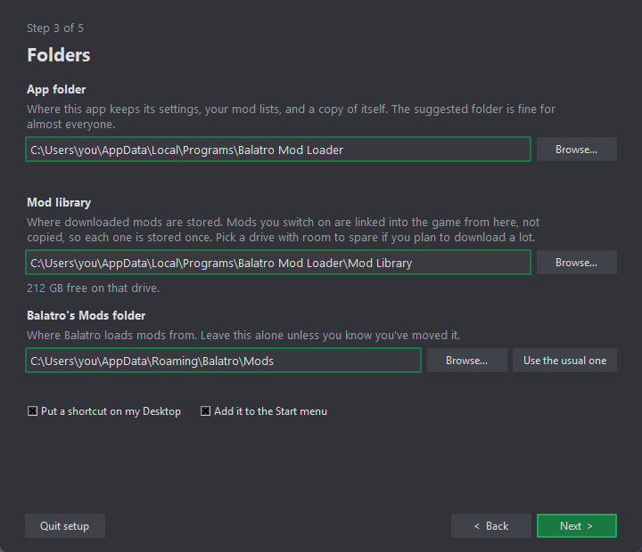
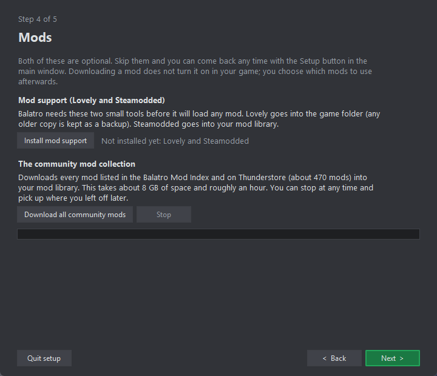

# Balatro Mod Loader

A mod manager for Balatro on Windows. It keeps your mods in one library and
switches them on and off for you, so you never drag folders in and out of
AppData again. It also tells you when a mod needs another mod to work, and
adds that one too.

Nothing gets downloaded and nothing in your game changes until you press a
button that says so.

## Install

1. Go to the [Releases page](../../releases) and download
   `Balatro Mod Loader.exe`.
2. Double-click it. The first time, Windows may say "Windows protected your
   PC", because the app isn't signed by a company. Click **More info**, then
   **Run anyway**.
3. The setup window opens. It asks three things, and each one has a
   **Browse…** button if you'd rather pick the folder yourself.

### Step 1: find Balatro



The app looks through your Steam libraries for Balatro. If it finds the game
you'll see a green line, and you just press **Next**.

If it can't find the game, click **Browse…** and pick `Balatro.exe`. To find
that file, open Steam, right-click Balatro, then choose **Manage**, then
**Browse local files**.

### Step 2: choose folders



- **App folder** is where the app keeps your settings and mod lists, plus a
  copy of itself. The suggested one is fine.
- **Mod library** is where downloaded mods are stored. It sits inside the app
  folder unless you move it. If you plan to download a lot, pick a drive with
  room to spare.
- **Balatro's Mods folder** is where the game loads mods from. Leave it alone.

Tick the boxes if you want a Desktop shortcut or a Start menu entry.

### Step 3: download (optional)



Both buttons are optional. You can skip this page and come back to it any
time with the **Setup…** button in the main window.

- **Install mod support** gets the two tools every Balatro mod needs:
  [Lovely](https://github.com/ethangreen-dev/lovely-injector), which goes into
  the game folder (any older copy is kept as a backup), and
  [Steamodded](https://github.com/Steamodded/smods), which goes into your mod
  library. If you've never modded Balatro before, press this one.
- **Download all community mods** downloads every mod in the
  [Balatro Mod Index](https://github.com/skyline69/balatro-mod-index) and on
  [Thunderstore](https://thunderstore.io/c/balatro/). That's about 470 mods,
  around 8 GB, and roughly an hour. You can press **Stop** whenever you like,
  and pressing the button again later picks up where it stopped.

Downloading a mod only puts it in your library. None of them are switched on
in the game until you choose them.

## Using it

The main window lists every mod in your library.

1. **Double-click a mod** to add it to your mod list (the app calls a mod
   list a *profile*). Anything it needs to work gets added too, shown in
   green.
2. Red rows mean something's wrong, such as a missing dependency or two mods
   that don't get along. The panel on the right says what.
3. Press **Apply to game…**. You'll see exactly what will change, and nothing
   happens until you confirm.
4. Press **Launch Balatro**.

You can keep several profiles, say one for a big content pack and one for
small tweaks, and switch between them with the **Profile** box at the top.
Switching doesn't copy or delete anything. The app links mods from your
library into the game, so every mod is stored once.

**Add mod…** adds a mod from a GitHub link. **Capture installed** takes mods
you installed by hand (from Discord, say) and brings them into your library so
they can be switched on and off like the rest.

## Questions

**Will this mess up mods I already installed by hand?**
No. The app never deletes a folder it didn't create. If a mod you installed
yourself is in the way, it stops and asks. Say yes and it moves the folder to
`%APPDATA%\Balatro\Mods-bml-backups` instead of deleting it.

**How do I go back to playing without mods?**
Rename `version.dll` in the Balatro game folder (to `version.dll.off`, say).
That's Lovely, and without it Balatro ignores every mod. Rename it back to
turn mods on again.

**How do I uninstall the app?**
Make a new profile with nothing in it and press **Apply to game…**, so the
game isn't left pointing at mods that are about to disappear. Then delete the
app folder and the mod library, the shortcuts, and
`%LOCALAPPDATA%\Balatro Mod Loader`, which holds one small settings file.
If you want modding gone entirely, also delete the `Steamodded` folder in
Balatro's Mods folder and `version.dll` in the game folder.

**Where do the mods come from?**
From their authors' own GitHub and Thunderstore pages, through the public
community index. This app doesn't host or change any mod.

**Is it Windows only?**
Yes. It uses Windows folder links and the Windows Steam layout.

## Running from source

Needs Python 3.10 or newer.

```
py -m pip install -r requirements.txt
py -m bml.main gui
```

The command line, the build script, the tests and how the pieces fit are in
[docs/DEVELOPING.md](docs/DEVELOPING.md).

## License

MIT. See [LICENSE](LICENSE). Every mod belongs to its own author and has its
own license.
